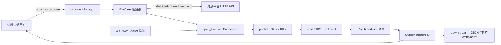

# 架构说明

本文面向维护者，说明当前实现的模块边界、会话生命周期与并发约束。配置和运行步骤见 [README](../README.md)，开发与验证方法见 [开发指南](development.md)，平台协议资料见 [开放平台文档](open-live/README.md)。

当前项目提供开放平台客户端、进程内会话管理及下游 WebSocket 服务。下文中的“订阅者”指持有
`Subscription` 的调用方，也包括每条下游连接；外部协议见 [客户端协议](downstream-protocol.md)。

## Crate 边界

依赖方向为 `bridge-native → bridge-core`。核心仅处理显式输入，不读取环境变量、不生成随机数、不访问时钟或网络。

`bridge-core::open_live` 包含签名、API 请求与响应模型、错误码、官方包解析及事件模型；`bridge-core::downstream::protocol` 定义下游消息；`bridge-core::delivery` 定义游标、事件记录与续传失败信息。

原生库沿用 `bilibili_live_bridge` 名称及公共模块路径，重导出共享类型。核心的 `ResponseError` / `ProtocolError` 在原生边界转换成原有 `ApiError` / `WsError` 变体，传输错误及其原始错误链仍由原生库保存。

`bridge-core::session::policy` 定义 `HealthPolicy`、`HeartbeatPolicy`、`ReconnectPolicy` 和 `UpstreamPolicy`，提供纯数值校验、显式抖动输入的退避计算和结构化配置诊断。`session::failure` 根据 `ApiFailure` / `UpstreamFailure` 摘要分类，保留批量过期错误与访问限制的处理规则。原生库重导出这些策略，现有调用路径不变。

native 的 `policy` 模块额外检查 Tokio 时钟可表示范围并输出诊断日志；网络适配器保留完整错误，仅将类别交给 core。随机抖动仍由 native 生成。core 不读取时钟、不生成随机数、不记录日志；`HeartbeatPolicy::validate` 不因风险提示拒绝配置，上游初始退避大于上限仍属于无效参数。

`Manager`、两类心跳、重连、日志保留策略与内存日志仍由 native 的 Tokio 运行时驱动。本次未将这些并发流程改写为跨运行时状态机。

## 模块边界

项目是包含 `bridge-core` 与 `bridge-native` 的 Cargo workspace。原生库入口是 [src/lib.rs](../crates/bridge-native/src/lib.rs)，可执行入口位于 [src/bin](../crates/bridge-native/src/bin/)。

| 模块 | 职责 | 主要入口 |
| --- | --- | --- |
| `config` | 读取和校验进程环境变量，保存项目配置 | `Config::from_env` |
| `logging` | 为可执行程序安装全局 tracing subscriber | `logging::init` |
| `open_live::api` | 对 JSON 请求签名，调用开启、关闭、单场和批量心跳 API | `Client`、`StartResult` |
| `open_live::ws` | 官方连接鉴权、WebSocket 心跳、包解码和直播事件解析 | `Connection`、`LiveEvent` |
| `session` | 按身份码和房间复用会话，维护订阅、批量项目心跳及清理流程 | `Manager`、`Subscription` |
| `downstream` | WebSocket 接入、JSON 封装、独立发送及连接任务收尾 | `serve` |
| `bin` | 组装库功能，处理服务和示例程序的退出及日志 | `server`、`http_auth`、`ws_listen`、`multi_client` |

会话层通过私有的 [Platform / LiveSocket](../crates/bridge-native/src/session/platform.rs) 调用平台能力。生产实现包装 `Client` 和 `Connection`，测试实现使用模拟平台。签名、二进制包和命令解析细节保留在各自模块内部。

## 标识与共享范围

| 标识 | 用途 |
| --- | --- |
| Access Key Id / Secret | 进程侧签名凭据，由配置传给 HTTP 客户端 |
| `app_id` | 一个 HTTP 客户端所属的开放平台项目 |
| 身份码 `code` | 开启互动的凭据，也是管理器接入索引 `by_code` 的键 |
| `room_id` | `start` 返回的房间号，作为 `by_room` 索引的键 |
| `game_id` | 一场互动的标识，用于项目心跳和结束调用 |

`Manager::clone()` 共享同一个内部 `State`。会话复用只发生在这个管理器及其克隆实例之间；分别构造的管理器、不同进程不会共享索引或心跳任务。

房间号不能替代身份码。管理器只有在 `start` 成功后才知道身份码对应的房间；如果平台拒绝另一身份码的开启请求，该次接入直接返回错误，不能保证转入已有房间会话。

## 会话接入与复用

接入逻辑位于 [manager.rs](../crates/bridge-native/src/session/manager.rs)。

1. `attach` 去掉身份码首尾空白，拒绝空码；管理器开始关闭后拒绝新的接入。
2. 在 `by_code` 中占位。首个调用方负责开启，后续同码调用方等待同一会话的状态变化，避免并发重复调用 `start`。
3. 开启成功后，根据返回的房间号查询 `by_room`。如果已有可加入的会话，尝试关闭这次重复开启的场次，将身份码关联到已有会话，并重定向等待者。
4. 如果当前调用拥有该房间，立即注册已取得的 `game_id` 的项目心跳，再建立官方 WebSocket 并完成鉴权，创建事件广播通道，将会话发布为 `Ready`。
5. 创建首个订阅，启动上游接收任务。后续订阅共享解析后的事件，项目心跳保持原有调度周期。

当同码的上一场会话已经开始关闭但尚未清理完成时，新的接入会等待清理，再尝试开启。`attach` 遇到接入过程中的 `Closed` 且管理器仍可用时，会额外尝试一次；运行期间的恢复由上游接收任务负责。

如果 `start` 失败，不调用 `end`。如果取得场次后建连失败，先移除项目心跳登记，再尝试 `end`，并通过 `SessionError::Connect` 保留建连失败和结束失败的说明。建连期间项目心跳失效或主动关闭管理器时，会取消建连并清理已开启的场次。

## 状态与并发约束

内部 `Phase` 使用 watch 通道向等待者发布状态：

| 状态 | 含义 |
| --- | --- |
| `Starting` | 正在开启场次或建立官方连接，同码接入等待结果 |
| `Ready` | 房间、场次、主播信息及事件通道已准备好 |
| `Attach` | 当前占位会话重定向到另一个已有会话 |
| `Failed` | 接入未完成，等待者收到对应的 `SessionError` |
| `Closed` | 已建立的会话完成清理，事件发送端被释放 |

“正在关闭”由订阅计数中的 `closing` 标记和停止信号表达，不是独立的 `Phase`。因此看到 `Ready` 仍需在订阅计数锁内确认可以加入，避免新订阅进入正在清理的会话。

实现维护以下约束：

- `tables` 锁保护身份码和房间索引的联动更新；网络请求和等待操作在释放锁后进行。
- `tables.sessions` 独立登记全部会话的生命周期。跨码复用时，即使索引已经重定向，原占位会话仍保留到重复场次的 `end` 完成，使 `shutdown` 能等待这次清理。
- 订阅计数、闲置截止时间与 `closing` 使用同一把锁。默认最后一个订阅释放后立即停止；配置宽限期时登记截止时间，重连取消截止时间。到期再次在锁内确认无人订阅并禁止加入。
- 删除索引和处理心跳结果时会比较会话指针，避免旧会话的清理影响已经替换的索引项。
- `Notify` 的等待先注册通知，再检查完成标记，避免检查与等待之间丢失唤醒。
- 会话到管理器、心跳登记到会话使用弱引用；活动上游任务持有管理器状态，直到清理结束。

首个接入任务还持有 `Leader` 清理守卫。如果接入 future 被取消，守卫发布失败；已经取得 `game_id` 时会另起任务尝试结束场次。这属于尽力清理：HTTP 响应尚未返回时无法知道远端是否已开启，守卫派生的清理任务也不属于正常会话关闭的等待流程。需要完整退出流程时，应协调接入任务结束并等待 `shutdown`，保持 Tokio runtime 存活。

## 两类心跳

| 心跳 | 负责人 | 驱动方式 |
| --- | --- | --- |
| 官方 WebSocket 心跳 | 每条 `Connection` | 持续轮询 `Connection::recv`，发送二进制心跳包 |
| 项目心跳 | 每个 `Manager` 的统一任务 | 定时收集活动 `game_id`，调用 `batch_heartbeat` |

配置默认间隔均为 20 秒。`Config` 校验 WebSocket 间隔为 1–29 秒、项目间隔为 1–59 秒；
`Manager` 构造方法校验非零和时钟范围，`Connection::connect` 校验非零。
项目恢复策略通过 `HeartbeatPolicy` 提供；不安全的时间组合只警告，不修改原值。

统一项目心跳任务在首个场次成功开启并取得房间所有权后启动，包括 WebSocket 建连及多地址鉴权期间。
首次正常心跳等待一个周期；建连完成不会重新登记、刷新成功时间或重置失败计数。
后来加入的会话从下一轮正常心跳开始参与。每批最多 200 个 ID，一个管理器最多一个请求在途，
到期正常心跳优先于重试，积压的正常批次保留最初到期时间。正常调度迟到后从当前时刻延后下一轮。
`Client::batch_heartbeat` 会拒绝空列表、空 ID、重复 ID 和超限列表。

心跳结果按场次处理：

- 请求成功：`failed_game_ids` 中的场次立即关闭，其余场次刷新成功时间、清零失败计数、取消重试，回到共享正常周期。
- 暂时性错误：传输和解码错误，平台 `4003/4004/5000/5001/5002`、HTTP 408/425/5xx 等进入有限恢复。
- 访问限制：平台 `4009` 和 HTTP 429 进入恢复，重试延迟至少为正常心跳间隔；`4009` 也可能涉及权限。
- 永久错误：平台 `4000..4002/4005..4008/4010..4013/5003..5005/5011/7004/7005/8002`、
  本地参数错误以及其余 HTTP 4xx 立即关闭本批。
- 顶层 `7000/7003`：单 ID 请求关闭对应场次，多 ID 请求无法定位失败对象时有限恢复；其他未知业务码告警并有限恢复。

每个登记项保存最后确认成功时间、失败次数、重试时间和在途标记。
初始确认时间取场次登记时刻；首次失败后启用截止检查，默认在最后确认成功后 45 秒结束恢复。
连续失败次数只决定指数退避，不再以三次失败作为关闭条件。普通退避默认从 2 秒起、10 秒封顶，
使用同批共享的 ±20% 抖动因子；恢复场次按最早截止时间组批。每次重试重新调用 API，
重新生成时间戳、nonce 和签名，低层客户端自身不启动重试。

调度器同时轮询请求结果、正常周期、重试时间、恢复期限和停止信号。退避不阻塞其他批次；
10 秒请求超时和恢复截止独立处理，在途请求不能延迟场次清理。
结果应用及移除登记都核对会话身份，晚到结果不能恢复已关闭或替换的登记。
退出取消在途心跳和待重试项，不等待退避；后台结束守卫通知 `shutdown`。
等待期间不持有管理器强引用，登记或移除会唤醒调度器。

默认 45 秒预算依据收录文档中最短 60 秒窗口，为响应延迟和安全余量预留 15 秒。
恢复期限超过 45 秒、正常间隔加 10 秒请求超时不小于恢复期限，或初始退避超过上限时，
管理器只记录警告并保留配置，退避仍封顶。自定义不安全组合不能保证在平台失效前恢复；
如果首次失败时预算已耗尽，立即清理。格式错误、零值和时钟范围溢出仍返回参数错误。
环境变量与库入口见 README；调度实现位于 [heartbeat.rs](../crates/bridge-native/src/session/heartbeat.rs)。

使用低层 `Client` 和 `Connection` 时，调用方自己负责项目心跳。`Connection` 不会启动独立的心跳任务；长时间停止读取或在事件处理中阻塞，会影响 WebSocket 心跳和 Ping/Pong。

## 上游健康检查与原场次恢复

连接健康策略为 `ws::HealthPolicy`：发送默认最多等待 5 秒，鉴权成功后初始化 60 秒有效活动期限。
有效业务事件（含未知命令）或操作码 3 的官方心跳回复刷新活动期限。
发送成功、Ping/Pong、未知操作码及缓存出队不刷新；检查与心跳先于缓存事件输出。
发送状态及绝对期限保存在连接字段中，采用 poll_ready/start_send/poll_flush；取消 recv 不丢帧、不重复发送，也不刷新期限。
健康超时后释放传输层并返回 Transport 错误。低层 Connection 持续由 recv 驱动，不启动后台任务或自行重连。

`session::UpstreamPolicy` 组合健康策略和可选的 `ReconnectPolicy`，默认开启 120 秒原场次恢复。
上游任务持有 StartResult，保留原 game_id、鉴权信息、房间/身份码索引、事件通道和项目心跳。
释放旧连接后先尝试上次地址之后的候选集群，全部失败后按 2 秒起、10 秒封顶、±20% 抖动退避。
候选顺序先按首次出现去重再计算偏移：平台会重复同一个集群（实测 5 项里浙江出现两次），
若在未去重的列表上偏移，重复项会让刚失败的集群被连续尝试，浪费一份 10 秒握手期限。
每候选握手仍最多 10 秒，且整体受首次故障起算的绝对预算限制，包括旧连接释放和退避。
短暂成功不重置预算；连续健康一个活动周期（默认 60 秒）后清除旧预算；健康连接不会因旧预算到期被关闭。

传输失败、EOF、普通 Close 或健康超时可以恢复；协议错误、业务解码错误、明确鉴权拒绝以及
Close 1002/1003/1007/1008 终止。InteractionEnd 先转发，再终止；shutdown、闲置到期及项目心跳关闭信号优先取消恢复。
重连仅重新鉴权，原场次失效后不自动 start；原鉴权复用已用 `auth_reauth` 连真实平台验证通过，跨集群切换仍只由本地桩覆盖。
预算耗尽或终止错误共用现有清理路径，end 只调用一次。

Phase::Ready 在恢复期间仍表示可以订阅；独立 watch 通道发布 Connected/Reconnecting/Closed 的上游快照。
`Subscription::watch_status()` 不混入直播事件；下游先 ready，再发送当前状态，恢复通知优先于恢复后事件。
状态可合并中间变化，最终 closed 仍等待事件缓冲交付。恢复空窗无补发，暂不跨连接去重。

## 事件解析与订阅

[packet.rs](../crates/bridge-core/src/open_live/ws/packet.rs) 按 16 字节大端包头拆包，支持原文和 zlib 压缩包，以及同帧多包、嵌套压缩。单包长度、解压输出、包数量和嵌套深度都有上限；新增协议支持时需要保留这些限制。

[cmd.rs](../crates/bridge-core/src/open_live/ws/cmd.rs) 根据 `cmd` 构造 `LiveEvent`。已知命令的缺失字段使用声明的默认值，字段类型不匹配会返回解析错误；未知字段不保留在已知事件结构中。未知命令保留 `cmd` 与原始 `data`，缺失的 `data` 为 JSON `null`。

只有 `InteractionEnd` 的 `ends_push()` 为真。普通 `LiveEnd` 是下播事件，仍会转发，不会单独触发会话关闭。

原进程内订阅与下游实时模式通过 broadcast 通道分发 `Arc<LiveEvent>`，避免为每个订阅者重复解析和复制事件正文。生产构造的广播容量为 256 条，当前不通过配置暴露。

- 新订阅只接收订阅之后广播的事件，不回放加入前的消息。
- 慢订阅者被覆盖的未读事件不会补发。`recv` 返回 `Lagged { skipped }`，再次读取从仍保留的事件继续。
- 订阅读取不会阻塞上游或其他订阅者。上游发送 `InteractionEnd` 后开始清理；订阅者可继续读完保留的事件，然后收到 `Closed`。
- 原实时模式没有持久化或重放。`downstream::protocol` 为 `LiveEvent` 提供独立序列化适配器，定义 `type / room_id / cmd / data` 消息；不改变官方事件枚举本身。

## 有界日志、确认模式与续传

[delivery.rs](../crates/bridge-native/src/session/delivery.rs) 为一个 Manager 的所有会话维护共享内存日志。
上游任务在解析事件后先序列化记录，再广播；即使没有订阅者也会记录。
日志保存共享的 JSON 数据、命令与桥侧 seq，流标识为随机 UUID；原场次上游恢复不重置。
独立 watch 只发布变化通知，读取游标和事件正文以日志为准，通知合并不会丢事件。
旧 broadcast 继续服务已有调用方；确认模式的生命周期守卫释放不使用的广播接收器。

日志默认保留 300 秒，全部流共享 32 MiB 记录字节预算，最多 128 条活动或结束流。
字节计入 JSON、命令与记录开销；元数据、传输缓冲、旧广播和临时序列化另计。
访问时清理过期事件，容量不足时跨流淘汰最早记录。超大单条事件形成明确缺口。
身份码归属以指纹保存，每条流最多保留最近 128 个关联身份码。
流数满时优先淘汰已结束流；没有可淘汰流时接入失败并清理新开启场次。

首次确认模式 attach 在取得订阅时采样日志尾部，ready 返回该起点；随后逐条读取，
因此采样与 ready 之间的新事件不会遗漏。续传先查询原 stream_id、身份码归属与保留范围，
可加入活动流并取消闲置期限，也可只回放已结束流；失败不调用 start。
结束流在清理平台场次后标记尾部完成并保留，不延长上游保活。
日志序号只覆盖桥成功记录的事件，不表示全部上游事件已到达。

下游 `ack:true` 启用默认 64 条未确认窗口，累计 ACK 必须同流、单调且不超出已发送位置。
写入开始前登记发送位置，允许客户端在 flush 完成前确认；ACK 不作为全局日志回收条件。
窗口满时仍响应心跳、状态与日志变化，发现未确认位置已淘汰则返回 resume_unavailable。
缺口检查失败后在 ACK 锁内复核最新确认位置，若确认已推进则重新检查，避免旧快照误断开。
有读取空间时由日志 recv 自己等待变化，额外的全局日志通知只在等待 ACK 时参与选择；
状态通知优先于这些唤醒，其他房间的持续写入不会压住就绪事件或状态。
日志读完结束流后等全部事件 ACK 再 closed；主动服务退出立即通知并清理。
已读完且全部确认的结束流先完成正常关闭，不再依赖其历史或元数据仍被保留。
重复交付由客户端 `(stream_id, seq)` 去重，客户端负责业务成功与游标保存；没有恰好一次保证。

日志不持久化，桥重启后原游标失效；保留范围外明确关闭，不静默降级到实时模式。
协议、默认值和客户端处理步骤见 [客户端协议](downstream-protocol.md)。

## 下游服务与闲置宽限期

`server` 绑定 `Config::listen()`，所有连接共享一个 `Manager`，并设置 `ManagerOptions::idle_grace`
为 30 秒。旧的 `Manager::new` 和 `Manager::from_config` 默认宽限期为零，保持立即清理行为。
每条 `/ws` 连接提交一次身份码，取得独立 `Subscription`；先发送 `ready`，再按序读取和发送事件。

每条连接的读写 future 并发运行，写端是唯一业务消息发送者，直接消费现有广播缓冲，不增加事件队列。
读端持续驱动控制帧，将首包和连接状态交给写端；实时模式缓冲覆盖映射成 `lagged`；确认模式读取日志并等待 ACK。发送失败或超时释放订阅。
Ping 发送开始前登记期望负载，读端只发布匹配当前 Ping 的确认；主动或旧 Pong 不会覆盖有效确认，也不会解除下一轮的超时。
接入期间断开仍推进 `attach` 至完成并释放结果。服务退出时同时推进 `Manager::shutdown` 和连接任务收尾，
不会直接 abort 接入任务。握手失败日志不记录客户端提交的头或 URL。

闲置截止时间通过 watch 通知上游任务，由其 select 循环驱动到期检查。宽限期间继续读取官方连接，
没有广播接收者时仍记录日志并保持两类心跳；新的实时订阅只接收加入后的事件，确认模式可按游标补发。互动结束、上游不可恢复错误、恢复预算耗尽、项目心跳失效
及主动 shutdown 都开始清理；闲置到期在上游恢复期间也优先中止恢复。

## 关闭与失败处理

最后一个订阅释放且闲置宽限期到期、上游恢复终止、收到 `InteractionEnd`、项目心跳达到关闭条件，以及调用 `Manager::shutdown`，都会触发会话关闭。

已建立会话的上游任务负责统一清理：

1. 标记会话正在关闭，取消接收并从心跳登记中移除。
2. 尝试发送 WebSocket 关闭帧，最多等待 5 秒；失败或超时仅记录日志。释放连接后继续调用 `end`，不让上游写端背压阻塞后续清理。
3. 移除房间和身份码索引，发布 `Closed`，释放事件发送端。
4. 标记清理完成并通知等待者。

`Subscription` 的析构只更新计数、发出停止信号，不等待网络清理。`Manager` 的析构也不代替 `shutdown`：退出前应显式等待 `shutdown().await`，它先禁止新接入、停止批量心跳，再关闭并等待所管理的会话，包括接入中的会话和正在清理的重复场次。重复调用不会重复关闭已经完成的会话。

`shutdown` 不返回清理错误。结束失败记入日志后，本地仍完成移除；返回表示本地清理流程结束，不保证平台确认结束成功，也没有结束失败的自动重试。上游有限恢复终止后，调用方需要重新 `attach`。

## 配置与日志边界

`Config::from_env` 只读取进程环境变量，不自动读取 `.env`。`RUST_LOG` 由日志初始化单独读取，`AUTH_CODE` 由示例程序读取；`server` 使用监听地址提供 `/ws`。

库只产生 tracing 事件，不自动安装全局 subscriber。可执行入口调用 `logging::init`；嵌入其他程序时也可以使用调用方已有的日志配置。后台会话任务和心跳任务显式携带 span 和当前 subscriber，以保留异步上下文。

日志以请求路径、项目、房间、场次、命令名和失败原因定位问题。
心跳日志补充错误类别、平台码、HTTP 状态、失败次数、重试延迟、剩余预算和关闭原因。
关闭原因包括 `failed_game_id`、`permanent_error` 和 `recovery_budget_exhausted`。
签名凭据、身份码、鉴权正文与请求体不作为日志字段；心跳分类器不记录平台 message。
示例程序在 debug 级别记录事件详情，可能包含弹幕等用户内容。过滤方式见 [README 的日志说明](../README.md#日志)。

## 设计取舍与当前边界

| 选择 | 理由与影响 |
| --- | --- |
| 按身份码占位，再按房间合并 | 同码并发只开启一次；跨码关联需要先取得平台返回的房间号 |
| 使用 broadcast 与共享事件 | 慢订阅者不会拖住其他订阅者，代价是缓冲溢出后丢失事件 |
| 每个管理器统一项目心跳 | 减少按房间发送的请求；大量会话需要分批顺序处理 |
| 用私有平台 trait 隔离网络 | 会话测试可以控制启动、连接、心跳和清理时序，无需真实凭据 |
| 将关闭集中在上游任务 | 订阅析构无需执行异步请求，完整退出需要显式等待管理器关闭 |

下游提供实时分发、30 秒内场次复用，以及确认模式的内存日志续传。上游支持原场次有限恢复；持久化、多实例协调和公网部署尚未实现。
修改这些边界时，应同步更新本文、客户端协议、公共接口注释和行为测试。
